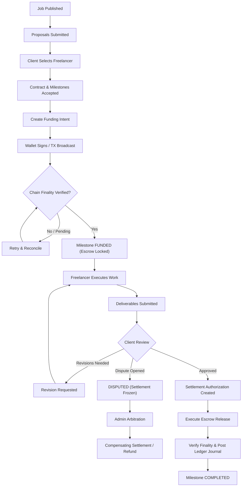

# 02 — Domain Workflows & Lifecycle State Machines

## 1. Actor Journeys

### 1.1 Client Journey
1. **Registration & Verification:** Create account, establish client profile, configure organization details.
2. **Job Publishing:** Specify title, scope, budget (in atomic minor units), deliverables, timeline, required skills, and preferred payment asset (TCC / CROWN).
3. **Proposal Evaluation:** Inspect freelancer bids, portfolios, technical milestones, and platform reputation.
4. **Contract Acceptance:** Mutually agree to a versioned contract with explicitly ordered milestones.
5. **Milestone Funding:** Generate an idempotent payment intent, sign funding transaction via CrownPay, and wait for verified chain confirmation.
6. **Deliverable Review:** Access submissions via private signed URLs. Request contract-bounded revisions or authorize milestone approval.
7. **Settlement & Feedback:** Authorize settlement release to the freelancer's account and leave bilateral feedback.

### 1.2 Freelancer Journey
1. **Profile Setup:** Establish skill taxonomy, portfolio artifacts, hourly rate, and payout wallet address.
2. **Opportunity Discovery:** Filter open jobs by budget, skills, and client verification status. Submit structured proposal.
3. **Contract Engagement:** Accept contract terms and milestone schedule.
4. **Funding Verification:** Inspect milestone status to ensure it is verified `FUNDED` before committing time and resources.
5. **Work Delivery:** Submit deliverable artifacts, notes, and repository links through private object storage.
6. **Revisions / Arbitration:** Review client revision notes or submit evidence if a formal dispute is opened.
7. **Settlement Payout:** Receive verified payout directly into designated wallet upon milestone completion.

### 1.3 Administrator Journey
1. **Governance & Moderation:** Inspect newly published jobs, flagged accounts, and identity verifications.
2. **Dispute Arbitration:** Review disputed contracts, immutable deliverable snapshots, participant communications, and timestamped audit logs.
3. **Binding Resolution:** Execute formal dispute verdicts (full release, partial release, full refund) within strictly defined platform authority limits.
4. **Ledger Audit & Reconciliation:** Inspect pending confirmations, reconciliation exceptions, and double-entry balance sheets.
5. **Emergency Mitigation:** Freeze compromised accounts or platform actions with append-only audit tracking.

> [!CAUTION]
> **Critical Administrator Constraint:** Administrators must NEVER have an unrestricted database balance editor. Every balance modification must take the form of an auditable, dual-authorized double-entry compensating ledger adjustment with an immutable business justification.

---

## 2. End-to-End Job-to-Payment Lifecycle



---

## 3. Contract & Milestone State Matrix

A common architectural trap is overloading a single `status` string to represent contract progress, payment intent status, and blockchain confirmation status. The system explicitly separates them:

| State Identifier | State Description | Allowed Next States | Permitted Actors |
| :--- | :--- | :--- | :--- |
| `DRAFT` | Contract terms being composed. | `AWAITING_ACCEPTANCE`, `CANCELLED` | Client |
| `AWAITING_ACCEPTANCE` | Proposal accepted; terms awaiting mutual confirmation. | `AWAITING_FUNDING`, `CANCELLED` | Client, Freelancer |
| `AWAITING_FUNDING` | Contract accepted; milestone awaiting escrow funding. | `FUNDING_PENDING`, `CANCELLED` | Client |
| `FUNDING_PENDING` | Payment intent created; transaction broadcast awaiting chain finality. | `FUNDED`, `AWAITING_FUNDING` (on fail) | System / Reconciler |
| `FUNDED` | Verified funds locked in escrow custody. Work may begin. | `IN_PROGRESS`, `SUBMITTED`, `DISPUTED` | Freelancer, Client |
| `IN_PROGRESS` | Freelancer actively developing deliverables. | `SUBMITTED`, `DISPUTED` | Freelancer, Client |
| `SUBMITTED` | Deliverables uploaded for client inspection. | `REVISION_REQUESTED`, `RELEASE_PENDING`, `DISPUTED` | Freelancer |
| `REVISION_REQUESTED` | Client requested scope-aligned modifications. | `SUBMITTED`, `DISPUTED` | Client |
| `RELEASE_PENDING` | Client approved delivery; settlement command queued. | `COMPLETED`, `DISPUTED` | Client, System |
| `COMPLETED` | Settlement verified; ledger journals posted; terminal state. | *None (Terminal)* | System |
| `DISPUTED` | Normal release frozen; awaiting arbitration verdict. | `RELEASE_PENDING`, `REFUND_PENDING` | Client, Freelancer |
| `REFUND_PENDING` | Admin arbitrated refund to client; payout queued. | `REFUNDED` | Admin, System |
| `REFUNDED` | Refund verified; ledger journal updated; terminal state. | *None (Terminal)* | System |
| `CANCELLED` | Engagement terminated prior to funded work; terminal state. | *None (Terminal)* | Client, Freelancer |

### Tripartite State Separation

```
┌─────────────────────────────────┐
│     Contract Milestone State    │ (e.g. FUNDED, SUBMITTED, COMPLETED)
└────────────────┬────────────────┘
                 │ drives
                 ▼
┌─────────────────────────────────┐
│       Payment Intent State      │ (e.g. CREATED, PENDING, CONFIRMED, FAILED)
└────────────────┬────────────────┘
                 │ correlates with
                 ▼
┌─────────────────────────────────┐
│     Blockchain Network State    │ (e.g. UNCONFIRMED, CONFIRMED, FINALIZED)
└─────────────────────────────────┘
```
