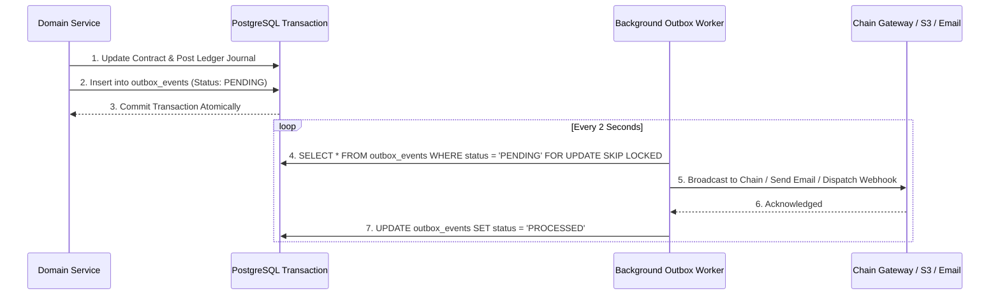

# 07 — Security Controls & Failure Recovery Protocols

## 1. Security Architecture & Controls

### 1.1 Identity & Authorization Guards
- **Zero Client-Side Trust:** Permissions are never determined by frontend visibility flags. Every API handler verifies authentication and checks resource ownership in the domain service layer.
- **BOLA Protection:** Direct object references (`/contracts/:id`) are strictly checked against `session.userId == contract.clientId || session.userId == contract.freelancerId || session.role == 'ADMIN'`.
- **Privilege Separation:** Administrative operations require dedicated role validation and multi-factor authentication (MFA) tokens for high-risk actions.

### 1.2 Wallet Security Policy
- **No Custody of Private Keys:** Private keys are NEVER accepted, stored, transmitted, logged, or exposed in application databases, environment variables, or client bundles.
- **Signing Boundary:** CrownPay signs transactions exclusively within its own isolated wallet runtime after presenting human-readable transaction summaries (intent ID, recipient address, atomic amount, network ID).

### 1.3 Private File Delivery Security
- Deliverables and dispute evidence are stored in private object storage (S3) with zero public access.
- Upload and download requests generate short-lived (15-minute) presigned URLs signed with AWS Signature Version 4.
- Content-type validation, file extension whitelisting, and checksum verification (`SHA-256`) occur before recording submissions.

---

## 2. Failure Recovery Matrix (9 Critical Scenarios)

The system is engineered to maintain financial correctness across all distributed failure modes:

| Failure Scenario | Root Cause | Mandated System Response |
| :--- | :--- | :--- |
| **1. Client Retries Funding** | Network drop or double click | Look up `idempotency_key`. Return existing `PaymentIntent` without re-initiating transfer. |
| **2. Chain Submission Times Out** | Node congestion or network drop | Mark transaction status `PENDING_VERIFICATION`. Background worker queries chain before initiating any retry. |
| **3. Duplicate Chain Webhook** | Third-party or indexer retry | Deduplicate by `(network_id, transaction_hash)`. Processing is idempotent and ignores duplicate notifications. |
| **4. Client Double Approval** | Concurrent approval requests | Acquire row-level database lock (`SELECT FOR UPDATE`). First commit transitions state to `RELEASE_PENDING`; second request fails state validation with `400 INVALID_STATE_TRANSITION`. |
| **5. Worker Crashes Mid-Settlement** | Infrastructure reboot | On restart, worker inspects outbox table. Checks whether transaction hash was mined on chain before broadcasting a replacement. |
| **6. Blockchain Reorganization (Reorg)** | Deep chain fork / consensus reorganization | Require chain-specific finality threshold ($N$ block confirmations) before transitioning milestone from `FUNDING_PENDING` to `FUNDED`. Stalled confirmations trigger reconciler investigation. |
| **7. Database Transaction Failure** | Lock contention or syntax error | Entire `prisma.$transaction` rolls back atomically. Zero outbox events or notifications are emitted for uncommitted state. |
| **8. Ledger vs Chain Discrepancy** | Unreconciled manual transfer | Periodic reconciliation detects variance: `Ledger Asset Balance != On-Chain Holding`. Automatically halts automated payouts on the asset and triggers P1 engineer alert. |
| **9. Admin Account Compromised** | Credential theft | Sessions instantly revoked via `session_version` invalidation. Sensitive actions require dual-authorization (four-eyes principle) and leave immutable, tamper-evident audit logs. |

---

## 3. The Transactional Outbox Pattern

To eliminate the dual-write problem (writing to a database and publishing to an external message queue or blockchain node simultaneously), all asynchronous side effects utilize the **Transactional Outbox**:

---

## 4. Security Verification Test Suite

Before production traffic is accepted, the automated test suite must verify:
- [x] Unauthorized access to another user's jobs, proposals, and contracts is blocked (403 Forbidden).
- [x] Freelancers cannot approve their own milestone releases.
- [x] Clients cannot submit deliverables on behalf of freelancers.
- [x] Duplicate funding requests for the same milestone do not create duplicate ledger entries.
- [x] Ordinary releases are strictly blocked while a contract is in `DISPUTED` state.
- [x] Released contracts cannot be released a second time.
- [x] Ledger journals strictly balance ($\sum \text{Debits} == \sum \text{Credits}$) across all paths.
- [x] Floating point budget or bid inputs are rejected at schema validation.
- [x] Tampered JWT session signatures are rejected (401 Unauthorized).
